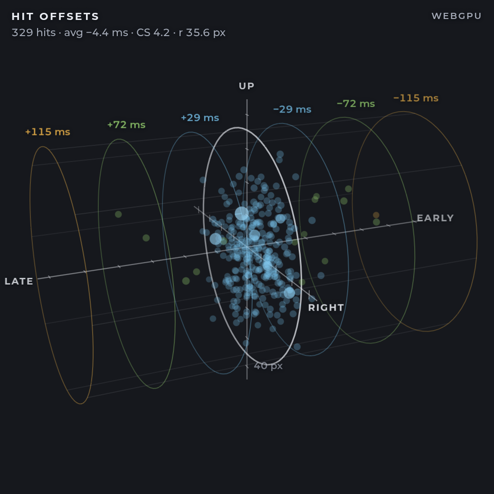

# Hit Offsets 3D

A [vosu](https://github.com/shiruviaa/vosu) overlay that plots every osu!standard hit of the current play in 3D: how far the cursor was from the note's centre (x and y, in osu! pixels) and how early or late the press was (z, in milliseconds). It works in OBS and in-game through [vosulay](https://github.com/shiruviaa/vosulay). The background is transparent.



## What it shows

- **Hits.** One point per hit. The x/y position is the cursor's offset from the note's centre: right is right, up is up. The depth is the hit error. Points are coloured by the timing window they landed in (300 / 100 / 50). A new hit starts larger and brighter, with a line down to the zero-error plane, then shrinks and fades into the history over the fade duration.
- **Hit circle.** The bright ring is the hit circle at zero error. Its radius comes from the beatmap's circle size after mods (`r = 54.4 − 4.48 × CS` osu! pixels), so every hit lands inside it.
- **Timing windows.** One ring on each side of the hit circle for each of the 300, 100 and 50 windows. The windows are in real milliseconds, after DT/HT, and the hits are put on the same scale.
- **Scales.** Ticks on the x and y axes are spaced in osu! pixels, and the bottom tick is labelled. Ticks on the time axis are spaced in milliseconds, and the window rings are labelled with their edges. The info line shows the hit count, the average error, the circle size and the hit-circle radius.
- **Camera.** It orbits slowly by itself. In a browser you can drag to orbit, scroll to zoom and double-click to reset.

The plot only appears in osu!standard, the only ruleset with hit offsets. By default it shows during gameplay and on the results screen, and it starts over on every retry or new map.

## Requirements

- **vosu 1.1.0 or newer.** The overlay reads `hitOffsets`, a vosu-only field added in 1.1.0. On older vosu versions, or on tosu, it shows a notice instead of hits.
- A Chromium-based browser source: OBS, vosulay or a regular browser.

## Installation

1. Download this repository (**Code → Download ZIP**), extract it, and take the `hit-offsets-3d` folder.
2. Move the folder into vosu's static folder:

   | System | Static folder |
   | --- | --- |
   | Windows | the `static` folder next to `vosu.exe` |
   | Linux | `~/.local/share/vosu/static/` (or `$XDG_DATA_HOME/vosu/static/`) |

   If you set `STATIC_FOLDER_PATH` in vosu's settings, use that folder instead. The overlay must sit directly inside it, as `static/hit-offsets-3d/index.html`.
3. Open the vosu dashboard (`http://127.0.0.1:24050/`). **Hit Offsets 3D** appears with your other overlays, at a recommended size of 520×520. Add it to OBS with the URL on its card, or place it in-game with vosulay.

To update, replace the folder. vosu keeps your settings outside the folder, so they survive the update.

## Settings

Open the overlay's settings from the vosu dashboard. They use the tosu settings format (`settings.json`, plus vosu's `settings.schema.toml`). The overlay loads them with the usual `getSettings` command on `/websocket/commands` and applies changes as soon as you save.

| Setting | Default | |
| --- | --- | --- |
| Visibility | gameplay + results | gameplay only, gameplay and results, or always |
| Point size (px) | 7 | diameter of a settled hit |
| Fade duration (s) | 3 | how long a new hit stays emphasised |
| Faded opacity | 0.35 | opacity of older hits |
| Max points | 1500 | the most recent hits drawn |
| Auto-rotate speed (°/s) | 10 | 0 stops the camera; negative values reverse it |
| Show axis labels | on | directions, the px scale and the window edges |
| Show info | on | title, hit count, average error, CS and radius, renderer |
| 300 / 100 / 50 colour | `#79c7f2` / `#9ad672` / `#f0b54a` | colours for hits and rings in each timing window |

## Renderer

The overlay picks a renderer when it starts. It tries **WebGPU** first, then **WebGL2**, then **WebGL1** (with `ANGLE_instanced_arrays`), and uses the first one that initialises. A browser without WebGPU, or one where no adapter is available, falls back to WebGL without any setup. All three draw the same picture with the same maths: the WGSL and GLSL shaders mirror each other, and both read one shared uniform block. The renderer in use is shown in the top-right corner when **Show info** is on.

If the GPU device or WebGL context is lost, the overlay rebuilds the renderer on a fresh canvas. After a second loss it stays on WebGL.

To force a renderer, add `?renderer=` to the overlay URL:

| Value | Tries |
| --- | --- |
| `auto` (default), `webgpu` | WebGPU → WebGL2 → WebGL1 |
| `webgl`, `webgl2` | WebGL2 → WebGL1 |
| `webgl1` | WebGL1 |

The renderers upload vosu's array without converting it. The stride-3 `hitOffsets` triples sit in a `Float32Array` that becomes the instance buffer as it is (one `vec3` per point). A parallel buffer holds each hit's arrival time for the fade. Only hits that arrived since the last frame are uploaded.

| Renderer | Screenshot |
| --- | --- |
| WebGPU | [docs/webgpu.png](docs/webgpu.png) |
| WebGL2 (`?renderer=webgl`) | [docs/webgl2.png](docs/webgl2.png) |
| WebGL1 (`?renderer=webgl1`) | [docs/webgl1.png](docs/webgl1.png) |
| Automatic fallback, browser started without WebGPU | [docs/auto-without-webgpu.png](docs/auto-without-webgpu.png) |
| Transparent background, as OBS or vosulay sees it | [docs/transparent.png](docs/transparent.png) |

## Data

| Source | Used for |
| --- | --- |
| `/websocket/v2/precise`, top-level `hitOffsets` | the hits: `[x0, y0, e0, x1, y1, e1, …]`, where x/y are cursor minus the note's stacked centre in osu! pixels (HR flip applied) and e is the hit error in ms |
| `/websocket/v2/subscribe` with `/state/number`, `/play/mode/number`, `/beatmap/stats/cs/converted`, `/beatmap/stats/hitWindow`, `/play/mods/rate`, `/beatmap/checksum` | visibility, the ruleset, the hit-circle radius, the window rings, rate scaling and map changes |
| `/websocket/commands` | settings |

`hitOffsets` is also in `/json/v2` and `/websocket/v2` as `play.hitOffsets`. The overlay uses the precise stream because it updates at the precise poll rate (10 ms by default). The overlay sends `applyFilters:["hitOffsets"]`, so each precise frame carries only that array. vosu still resends the whole array every frame, so the overlay skips frames identical to the previous one. A frame that only grew is parsed from where the previous frame ended, so a long map stays cheap on the main thread that vosulay's overlays share.

The array grows with each hit during a play. When it gets shorter, or its last known hit changes (a retry), or the beatmap checksum changes, the plot starts over. If the overlay opens mid-play, the hits that already happened are shown already faded. Every socket reconnects with backoff (250 ms, doubling up to 5 s).

The meta fields come from `/websocket/v2/subscribe`, vosu's selected-field version of `/websocket/v2`, instead of the full `/websocket/v2` document. Only those six values cross the wire.

## Development

There is no build step. The overlay is plain ES modules plus one bundled font.

- **Demo mode:** `?demo=1` runs a synthetic osu!standard play (CS 4.2, OD 8.5) through the same decoder and store as live data. It starts mid-play with 320 hits, adds hits in streams and jumps, and retries after 900 hits. `&seed=N` picks another synthetic player, and `&bg=%2316181d` paints a backdrop behind the transparent page.
- **Screenshots:** `bun tools/screenshot.ts <out.png> [query] [--no-webgpu] [--size 520x520] [--scale 2] [--wait 3000] [--base URL]` serves the folder locally, loads it in headless Chromium over the DevTools protocol and saves a PNG. No window opens. WebGPU and WebGL run on SwiftShader, so no GPU is needed. Chromium comes from `$CHROME`, then from `PATH`, then from the newest Playwright build. `--no-webgpu` starts Chromium without WebGPU to exercise the automatic fallback. `--base` points at an overlay served by a running vosu. The previews in `docs/` were made with:

  ```sh
  bun tools/screenshot.ts docs/webgpu.png "demo=1&bg=%2316181d"
  bun tools/screenshot.ts docs/webgl2.png "demo=1&renderer=webgl&bg=%2316181d"
  bun tools/screenshot.ts docs/webgl1.png "demo=1&renderer=webgl1&bg=%2316181d"
  bun tools/screenshot.ts docs/auto-without-webgpu.png "demo=1&bg=%2316181d" --no-webgpu
  bun tools/screenshot.ts docs/transparent.png "demo=1"
  ```

## License

[MIT](LICENSE), except the bundled [Montserrat](https://github.com/JulietaUla/Montserrat) font (SIL Open Font License 1.1, see `hit-offsets-3d/fonts/OFL.txt`).
